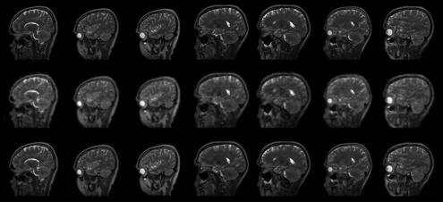

# Diffusion-Bridge Unfolding for MRI Reconstruction

Kaiyuan (Sam) Kang · Computational Imaging Group, Washington University in St. Louis · Summer 2025

## Abstract

This project combines an image-to-image diffusion bridge with deep unfolding for MRI reconstruction. Starting from an image formed from undersampled k-space, the bridge provides a learned prior for recovering the clean image. A time-dependent operator derived from the bridge mean provides a consistency update in image space. Experiments compared this approach with unfolding using the MRI forward operator and with a standalone diffusion bridge. One recorded reconstruction achieved **33.0364 dB PSNR**, **0.9365 SSIM**, and **0.0111 LPIPS**.

## Background

An undersampled MRI acquisition can be modeled as

$$
y = A x_0 + e, \qquad A = PFS, \qquad x_1 = A^\dagger y.
$$

Here, $x_0$ is the reference image, $y$ is the acquired k-space, and $e$ is measurement noise. The operator $S$ applies coil sensitivities, $F$ is the Fourier transform, and $P$ selects acquired samples. The fixed linear map $A^\dagger$ forms the degraded image initializer $x_1$. The notation $A^{\mathrm H}$ denotes the Hermitian adjoint.

Deep unfolding alternates a consistency step from the acquisition model with a learned image update. An image-to-image diffusion bridge learns a restoration process between the degraded and clean endpoints. This project uses the bridge as a learned prior and adds an explicit consistency step to guide the reconstruction. The bridge formulation follows [I²SB by Liu et al. (ICML 2023)](https://proceedings.mlr.press/v202/liu23ai.html).

## Derivation

### Unfolding with the MRI forward operator

The conventional data fidelity term measures disagreement with acquired k-space. Initialize $\hat{x}_0=x_1$ and define

$$
L_A(x)=\tfrac12\lVert Ax-y\rVert_2^2.
$$

At unfolding step $k$, a gradient step is followed by a learned image update.

$$
\begin{aligned}
z_k &= \hat{x}_k-\gamma_k A^{\mathrm H}(A\hat{x}_k-y),\\
\hat{x}_{k+1} &= \lambda_k D_\theta(z_k,t)+(1-\lambda_k)z_k.
\end{aligned}
$$

Here, $\gamma_k$ is the gradient step size, $\lambda_k$ controls the blend, and $D_\theta(\cdot,t)$ is the learned image map conditioned on diffusion time $t$.

### Unfolding with the bridge operator

The bridge mean at time $t$ is a weighted average of the clean and degraded endpoints.

$$
s_t = \alpha_t x_0+(1-\alpha_t)x_1, \qquad \alpha_t\in[0,1].
$$

Substituting $x_1=A^\dagger(Ax_0+e)$ gives an effective forward model for the bridge mean.

$$
\begin{aligned}
s_t &= \alpha_t x_0+(1-\alpha_t)A^\dagger(Ax_0+e)\\
    &= \big[\alpha_t I+(1-\alpha_t)A^\dagger A\big]x_0
       +(1-\alpha_t)A^\dagger e\\
    &= H_t x_0+w_t,
\end{aligned}
$$

where $H_t=\alpha_t I+(1-\alpha_t)A^\dagger A$ and $w_t=(1-\alpha_t)A^\dagger e$. The term $w_t$ comes from the original measurement noise. The derivation describes the bridge mean, while a sampled bridge state also contains diffusion noise.

At fixed $t$, let $\hat{s}_t$ be the estimate of the bridge mean used in the unfolding stage. The bridge consistency term and updates are

$$
L_{H,t}(x)=\tfrac12\lVert H_t x-\hat{s}_t\rVert_2^2,
$$

$$
\begin{aligned}
z_k &= \hat{x}_k-\gamma_k H_t^{\mathrm H}(H_t\hat{x}_k-\hat{s}_t),\\
\hat{x}_{k+1} &= \lambda_k D_\theta(z_k,t)+(1-\lambda_k)z_k.
\end{aligned}
$$

The $A$-based update matches acquired k-space. The $H_t$-based update matches an estimated bridge mean in image space.

## Results

Experiments varied the number of unfolding steps and compared three approaches.

1. Standalone diffusion-bridge reconstruction.
2. Deep unfolding with the MRI forward operator $A$.
3. Deep unfolding with the bridge operator $H_t$.

*From top to bottom, the rows show the reference, degraded initializer, and reconstruction.*

The metrics below are from one recorded reconstruction example.

| PSNR | SSIM | LPIPS |
| ---: | ---: | ---: |
| 33.0364 dB | 0.9365 | 0.0111 |
